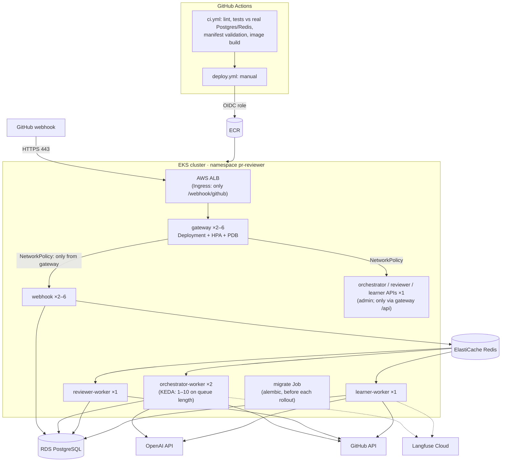

# Deploying to AWS (EKS)

Everything in this guide exists as files in the repo and is validated in CI. **Nothing is deployed.** Locally the
same containers run under `docker compose`; this page explains how they would run on AWS, matching the system
architecture diagram the project started from.

## From the diagram to the files

| Diagram box | Here |
|---|---|
| Public webhook URL / AWS ALB | `deploy/k8s/ingress.yaml`: AWS Load Balancer Controller, HTTPS (ACM certificate), TLS 1.3 policy; **only `/webhook/github`** is routed |
| Gateway / Webhook services | `gateway.yaml`, `webhook.yaml`: 2 replicas each, rolling updates with `maxUnavailable: 0`, HPA (CPU 70%, up to 6), PodDisruptionBudget, spread across AZs |
| Redis / ElastiCache | `REDIS_URL` in the Secret (`rediss://`, TLS); replaces the compose `redis` container |
| PostgreSQL RDS | `DATABASE_URL` in the Secret; replaces the compose `postgres` container |
| Orchestrator / Reviewer / Learner services | `apis.yaml` (their FastAPI apps, internal, reached only from the gateway) + `workers.yaml` (their Celery workers: one Deployment per queue, 120 s graceful shutdown for in-flight LLM calls) |
| Prometheus / Grafana | pod annotations `prometheus.io/*` + NetworkPolicy allowing the `monitoring` namespace (e.g. kube-prometheus-stack). The Grafana dashboard JSON works unchanged |
| LangFuse | unchanged: Langfuse Cloud, keys in the Secret |
| GitHub Actions → Docker build → AWS ECR → EKS | `.github/workflows/ci.yml` (every push/PR) and `deploy.yml` (manual) |

## Security choices

- **Least exposure.** Only the webhook path is on the internet (the ALB doesn't route the gateway's `/api/…`; use
  `kubectl port-forward` or an internal ALB for the admin API, which also requires `ADMIN_API_TOKEN`). The webhook service accepts traffic only from
  gateway pods, and `/metrics` only from the `monitoring` namespace. A default-deny NetworkPolicy covers everything
  else.
- **Hardened pods.** The namespace enforces the Kubernetes **restricted** Pod Security Standard: non-root (uid 1001),
  no privilege escalation, all Linux capabilities dropped, seccomp `RuntimeDefault`, **read-only root filesystem**
  with a small `emptyDir` at `/tmp`. Pods don't mount a service-account token, because the app never calls the
  Kubernetes API. Tested locally with `docker run --read-only --cap-drop ALL --user 1001`: gateway healthy, worker
  ready and serving metrics, migrations ran, writes to `/app` refused.
- **No long-lived AWS keys.** The deploy workflow uses GitHub's **OIDC** token to assume an IAM role, so credentials
  last only for the job. Put the role behind a protected `production` environment to require an approval per deploy.
- **Secrets** (`secret.example.yaml` is a template only): store them in AWS Secrets Manager and sync them with the
  External Secrets Operator. The GitHub App private key is mounted as a read-only file, never as an environment
  variable.

## Deploy pipeline (`deploy.yml`)

1. Build the image and push it to ECR tagged with the **commit SHA** (never `latest`), so every pod's image says
   exactly which commit it runs.
2. `kustomize edit set image` points the manifests at that tag.
3. **Migrate first:** delete and re-create the `migrate` Job (Jobs are immutable), then wait for it to complete.
   Old pods are still running at that moment, so migrations must be backward compatible ("expand, then
   contract": add a column now, drop the old one in a later release).
4. `kubectl apply -k deploy/k8s`, then wait for each Deployment's rollout.
5. If anything fails, `rollout undo` every Deployment.

## Scaling notes

- **API pods** are cheap and CPU-bound, so a CPU HPA fits.
- **Workers** spend almost all their time *waiting* on OpenAI and GitHub, so CPU stays low even when the queue is
  backing up, and a CPU HPA would never react. `deploy/k8s/optional/keda-scaledobject.yaml` (needs KEDA) scales the
  orchestrator on the **length of the `review` queue** instead: one pod per 5 waiting reviews, 1–10 pods. The
  Grafana "Celery queue depth" panel shows the same signal.
- Celery's `acks_late` plus the 120 s grace period: a worker stopped mid-review either finishes or its task goes back
  on the queue. The run's status checks then make the retry safe.

## Rough monthly cost (us-east-1)

Approximate, on-demand prices; check the [AWS pricing calculator](https://calculator.aws/) before relying on them.

| Item | Size | ≈ USD / month |
|---|---|---|
| EKS control plane | 1 cluster | 73 |
| Worker nodes | 2 × t3.medium | 61 |
| NAT gateway | 1 (+ data) | 33+ |
| Application Load Balancer | 1 (+ LCUs) | 18–25 |
| RDS PostgreSQL | db.t4g.micro, 20 GB gp3, single-AZ | 14 |
| ElastiCache Redis | cache.t4g.micro | 12 |
| ECR, CloudWatch logs | small | 2–5 |
| **Infrastructure total** | | **≈ 215–235** |
| OpenAI (gpt-4o-mini) | about $0.0027 per review | 1,000 reviews ≈ $3 |

The LLM is the cheap part; the fixed cost is mostly EKS and networking. For a single team, the same images run fine
on ECS Fargate, or on one small EC2 instance with this repo's `docker-compose.yml` (about $15–30/month). EKS pays
off once you need the scaling, isolation and rollout guarantees above.

## Before a first real deploy

1. Create the VPC, EKS cluster (with the AWS Load Balancer Controller), RDS, ElastiCache, ECR repository and an
   ACM certificate (Terraform is the natural next step; not included here).
2. Create the GitHub OIDC IAM role and set the repo variables listed at the top of `deploy.yml`.
3. Create the two Secrets (from `secret.example.yaml`, via Secrets Manager + External Secrets).
4. Replace the placeholders: the ECR account and region in both `kustomization.yaml` files, the certificate ARN and
   host in `ingress.yaml`, and the VPC CIDR in `network-policies.yaml`.
5. Run **Deploy** from the Actions tab, then point the GitHub App's webhook URL at `https://<host>/webhook/github`.
