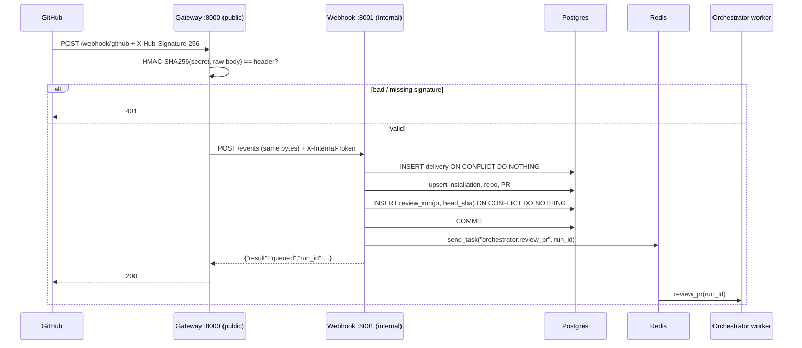

# Learning notes

Short write-ups of the ideas each phase teaches, with pointers into the code.

## Phase 1 — Event ingress (gateway + webhook)



**HMAC signature** (`services/gateway/signature.py`). GitHub signs the *raw bytes* of the body with the webhook
secret. We compute the same signature and compare them with `hmac.compare_digest` (constant time, so an attacker
can't guess it byte by byte from timings). The body must be verified *before* parsing: reformatted JSON would have a
different signature.

**Why a separate gateway?** It's the only service with a public port. It does one cheap, security-critical thing
(reject fakes) and forwards the identical bytes. The webhook service has no host port, and it also checks
`X-Internal-Token`, so even something else on the network can't inject events. In AWS, the ALB → gateway hop stays
the same.

**Two layers of de-duplication** (`services/webhook/handlers.py`):

| Layer | Key | Catches |
|---|---|---|
| Delivery | `X-GitHub-Delivery` (PK of `webhook_deliveries`) | GitHub retries and manual "Redeliver" clicks |
| Commit | `UNIQUE(pr_id, head_sha)` on `review_runs` | Different events for the same commit (e.g. `reopened` after `opened`) |

Both use `INSERT … ON CONFLICT DO NOTHING RETURNING`, which is atomic in Postgres. Two identical webhooks
arriving at the same moment can't both "win"; a check-then-insert in Python could.

**Commit, then enqueue.** The Celery task is sent *after* the DB commit. If it were sent before, a fast worker could
look up `run_id` before the row exists. If Redis is down after the commit, we delete the delivery and run rows and
return 503. GitHub's redelivery is then treated as new instead of as a duplicate.

**`send_task` by name.** The webhook service enqueues `"orchestrator.review_pr"` as a string and never imports worker
code. Producer and consumer are coupled only by the task name and the queue (`common/celery_app.py`). That's what lets
them deploy and scale separately.

**Workers and asyncio.** Celery tasks are synchronous. Each task runs `asyncio.run(...)`, which makes a new event loop,
and asyncpg connections can't cross event loops. So `common/db/session.py` keeps one engine per loop and the
worker disposes of it at the end of the task.

**Testing without mocks of our own code.** Webhook tests hit the real Postgres inside a transaction that is rolled
back afterwards (`tests/conftest.py`), so `ON CONFLICT` behaves exactly as it does in production. Only the Celery
send is faked (FastAPI `dependency_overrides`). `test_gateway_to_webhook_end_to_end` chains both apps in-process
over `httpx.ASGITransport`.

Try it with the stack running:

```bash
./setup.sh event opened         # 200 queued
./setup.sh event opened         # 200 duplicate_sha
./setup.sh event synchronize    # 200 queued (new random SHA)
./setup.sh event opened --bad-signature   # 401
./setup.sh logs orchestrator-worker
```
