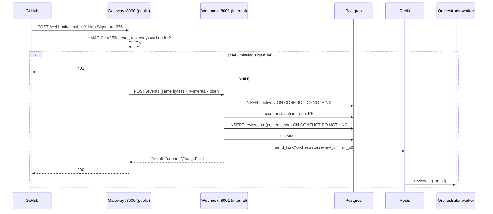
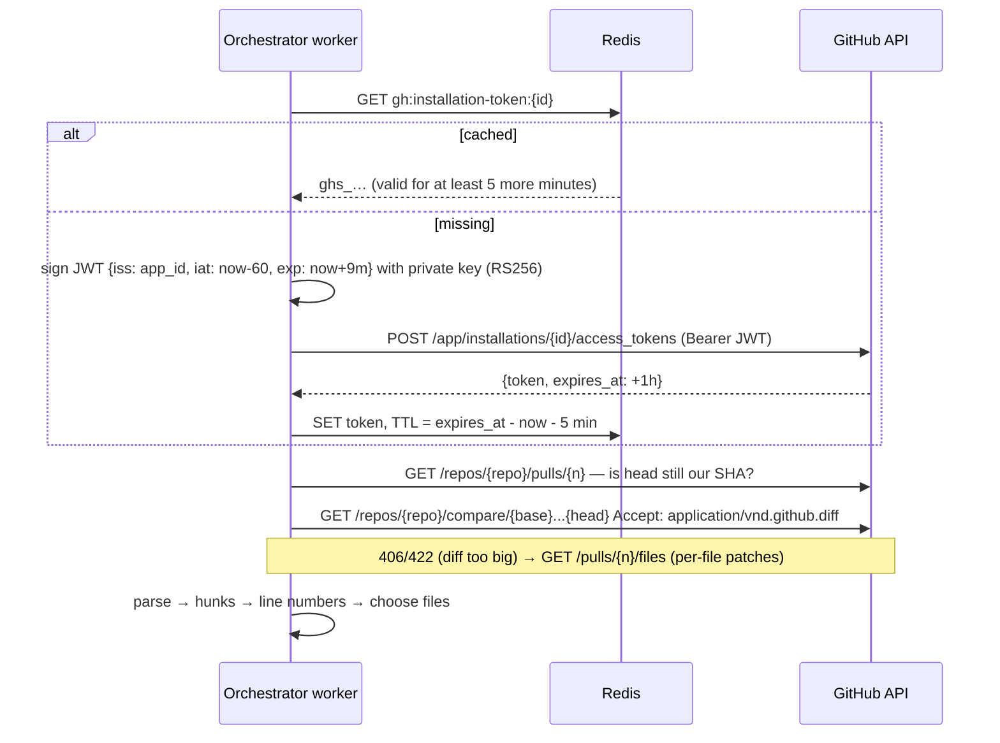
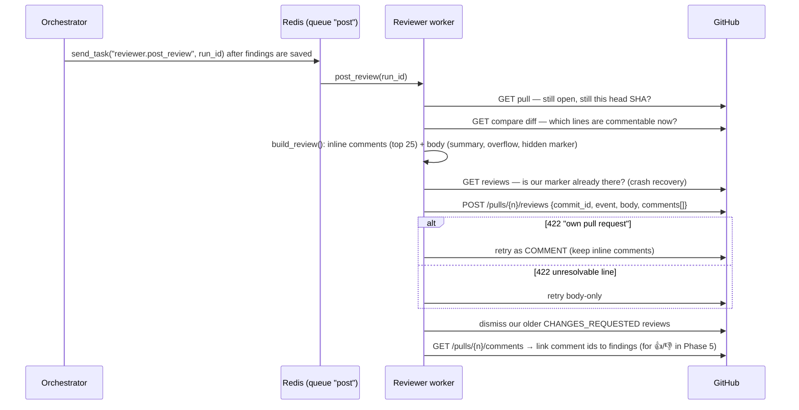

# Learning notes

Short write-ups of the ideas each phase teaches, with pointers into the code.

## Phase 1 — Event ingress (gateway + webhook)



**HMAC signature** (`services/gateway/signature.py`). GitHub signs the *raw bytes* of the body with the webhook
secret. We compute the same signature and compare them with `hmac.compare_digest` (constant time, so an attacker
can't guess it byte by byte from timings). The body must be verified *before* parsing: reformatted JSON would have a
different signature.

**Why a separate gateway?** It's the only service with a public port. It does one cheap, security-critical thing
(reject fakes) and forwards the identical bytes. The webhook service has no host port, and it also checks
`X-Internal-Token`, so even something else on the network can't inject events. In AWS, the ALB → gateway hop stays
the same.

**Two layers of de-duplication** (`services/webhook/handlers.py`):

| Layer | Key | Catches |
|---|---|---|
| Delivery | `X-GitHub-Delivery` (PK of `webhook_deliveries`) | GitHub retries and manual "Redeliver" clicks |
| Commit | `UNIQUE(pr_id, head_sha)` on `review_runs` | Different events for the same commit (e.g. `reopened` after `opened`) |

Both use `INSERT … ON CONFLICT DO NOTHING RETURNING`, which is atomic in Postgres. Two identical webhooks
arriving at the same moment can't both "win"; a check-then-insert in Python could.

**Commit, then enqueue.** The Celery task is sent *after* the DB commit. If it were sent before, a fast worker could
look up `run_id` before the row exists. If Redis is down after the commit, we delete the delivery and run rows and
return 503. GitHub's redelivery is then treated as new instead of as a duplicate.

**`send_task` by name.** The webhook service enqueues `"orchestrator.review_pr"` as a string and never imports worker
code. Producer and consumer are coupled only by the task name and the queue (`common/celery_app.py`). That's what lets
them deploy and scale separately.

**Workers and asyncio.** Celery tasks are synchronous. Each task runs `asyncio.run(...)`, which makes a new event loop,
and asyncpg connections can't cross event loops. So `common/db/session.py` keeps one engine per loop and the
worker disposes of it at the end of the task.

**Testing without mocks of our own code.** Webhook tests hit the real Postgres inside a transaction that is rolled
back afterwards (`tests/conftest.py`), so `ON CONFLICT` behaves exactly as it does in production. Only the Celery
send is faked (FastAPI `dependency_overrides`). `test_gateway_to_webhook_end_to_end` chains both apps in-process
over `httpx.ASGITransport`.

Try it with the stack running:

```bash
./setup.sh event opened         # 200 queued
./setup.sh event opened         # 200 duplicate_sha
./setup.sh event synchronize    # 200 queued (new random SHA)
./setup.sh event opened --bad-signature   # 401
./setup.sh logs orchestrator-worker
```

## Phase 2 — GitHub App auth and fetching the diff



**Two-step App auth** (`common/github/auth.py`). The private key never leaves the machine. It signs a short JWT that
only proves "I am App 1234567". GitHub swaps that JWT for an **installation token**, scoped to the repos and
permissions of one installation and valid for 1 hour. Every worker shares the token through Redis. It's thrown away
5 minutes early, so a slow task never starts a request with an expired token. If GitHub still answers 401 (for example
the App was reinstalled), the client deletes the cached token and mints a fresh one once.

**Exact commits, not "the PR".** The diff comes from `compare/{base_sha}...{head_sha}`, the commits stored on
the run. The three dots mean "changes since the merge base", which is what GitHub's *Files changed* tab shows.
Asking for "the PR's diff" could return a newer commit than the run is about. Before fetching, the worker checks the
PR's current head. If the author has pushed again, the run is marked `skipped` (*superseded*), because the newer
commit has its own run. That avoids paying for a review nobody will read.

**Line mapping** (`common/diff.py`). GitHub only accepts an inline comment on a line that is **in the diff**,
addressed by its line number in the *new* file. The parser records `new_no` for every added (`+`) and context (` `)
line; removed lines (`-`) have none. `render()` prints those numbers in the margin of the text the agents read:

```
### app/db.py (modified, +2 -1)
@@ -10,5 +10,6 @@ def get_user(conn, user_id):
   10       cur = conn.cursor()
      -     cur.execute("SELECT * FROM users WHERE id = %s", (user_id,))
   11 +     query = f"SELECT * FROM users WHERE id = {user_id}"
   12 +     cur.execute(query)
```

So when the security agent says "line 11", that's a real, commentable line. Phase 3 still checks every line number
against `commentable_lines()` before keeping a finding.

**Why the parser counts lines.** Each hunk header (`@@ -10,5 +10,6 @@`) says how many old and new lines follow. The
parser reads exactly that many. Otherwise a removed SQL comment `-- note` (shown as `--- note`) would look like a new
file header. If a header claims more lines than exist, the parser stops at the next `@@` rather than misnumbering
everything after it.

**What gets skipped** (`select_reviewable`): deleted files, binaries, renames with no changes, lockfiles,
generated/minified/vendored files, assets, files with more than 1500 changed lines, and anything past `MAX_DIFF_LINES`
for the whole PR. Skipped files are listed (Phase 4 puts them in the summary), so nothing disappears silently.

**Retries.** 5xx, 429 and rate-limit 403s are retried inside the client with backoff, honouring `Retry-After`. If
GitHub is still failing, `GitHubRetryable` makes Celery retry the whole task later (30 s, 60 s, … up to 10 min, 5
times) before the run is marked `failed`. A 404 or 422 isn't retried, because retrying won't fix it.

## Phase 3 — Four parallel agents with LangGraph

```mermaid
flowchart LR
    START --> static & security & architecture & style
    static & security & architecture & style --> merge --> summarize --> END
```

**Parallel fan-out and fan-in** (`services/orchestrator/graph/graph.py`). LangGraph runs in *supersteps*. Every node
whose inputs are ready runs in the same superstep, concurrently. The four agents all hang off `START` with no edges
between them, so they run together. `merge` has an edge from each agent, so it waits for all four (fan-in). On the
real PR the four agents finished within 0.8 s of each other (6.6–7.4 s each), so the whole review took about as long
as the slowest agent, not the sum of all four. `test_four_agents_run_in_parallel_and_merge` proves it: four agents
that each sleep 0.3 s finish in under 0.9 s, with all four in flight at once.

**Reducers.** Four nodes write `raw_findings` in the same superstep. With a plain field the last writer would win
and three agents' work would vanish. `Annotated[list, operator.add]` tells LangGraph to *concatenate* the
updates instead.

**Structured output.** `llm.with_structured_output(AgentReport, include_raw=True)` uses OpenAI's strict JSON-schema
mode, so the model *cannot* return anything but the Pydantic shape. Strict mode requires every field, which is why
"optional" fields are `X | None` with no default. `include_raw=True` also returns the raw message, which carries the
token usage used for cost.

**Failure isolation.** Each agent node catches its own errors and records them on `AgentRun`. A timed-out style agent
still leaves you a security review. The summary notes which reviewers failed, and the run fails only if *all* of
them did.

**What tuning taught us** (PR #1, before → after):

| Problem seen in the raw output | Fix |
|---|---|
| Every agent reported the obvious SQL injection; static/architecture missed their own issues (leaked connections, unchecked `is_admin`) | Prompts: "security issues belong to the security reviewer, do NOT report them" + a concrete checklist per agent |
| SQL injection labelled A01 (by non-security agents), winning the merge | Only the security agent may set `owasp_id` |
| Style agent reporting "medium" issues | Severity cap: style ≤ low, architecture ≤ medium |
| "Hard-coded secret key" and "Avoid hard-coded secrets" on the same line kept separately | Same-line matching is looser, and plurals fold ("secrets" = "secret") |

Result: correct OWASP ids (A02/A03/A05/A01). It now also finds the 3 leaked connections and the missing authorization
check, for about $0.0025 a review. LLM reviews are not deterministic: the N+1 query loop is found on some runs and
not others. That's why the merge step validates everything and why the Learner (Phase 5) exists.

**Merge rules** (`graph/merge.py`):
1. Drop confidence < 0.5 and unknown files; a path like `users.py` is matched to `app/users.py`.
2. Line not commentable on GitHub → keep the finding but make it file-level (it goes in the summary).
3. Same file, same line (or within 2 lines with the same category or similar title) → one finding. The agents' names
   are combined, the worse severity wins, and the first suggestion is kept.
4. Sort by severity. Each finding gets a `fingerprint` (category + normalised title words) so the Learner can count
   recurring problems across PRs.

**Verdict by rule, not by model:** any critical/high → `request_changes`; any low/medium → `comment`; else
`approve`. The model writes the prose summary, but code decides the verdict, because a verdict should be
predictable.

**Try it without GitHub:**

```bash
git diff main > /tmp/change.patch
uv run python -m services.orchestrator.cli /tmp/change.patch --title "My change" --details
./setup.sh runs                                   # recent runs, tokens, cost
./setup.sh show priyambansal13/PR-reviewer#1      # findings of a PR's latest run
./setup.sh rereview priyambansal13/PR-reviewer#1  # run it again
```

**Bug found live: "Event loop is closed".** On PR #3 the architecture agent died in 0.0 s. Each Celery task used
to call `asyncio.run()`, which creates and then *closes* an event loop per task. The OpenAI SDK keeps one HTTP
connection pool per process, so the next task found pooled connections tied to the dead loop, and whichever agent
grabbed one first crashed. Failure isolation kept the review going with three agents, but the real fix
(`common/aio.py`) gives each worker process **one long-lived loop** that runs every task. Connection pools (OpenAI,
Postgres) now stay valid and warm between tasks. Three back-to-back reviews on the same worker process then ran all
four agents cleanly.

## Phase 4 — Posting the review on the PR



**One review, not many comments.** `POST /pulls/{n}/reviews` creates the summary and all inline comments
*atomically*: the PR gets one notification and one "Review" entry, and either everything is posted or nothing is.

**Separate service, separate queue.** The orchestrator only saves findings and enqueues `post_review`. Posting can
fail or be retried (rate limits, GitHub outages) without paying for the LLM again, and `./setup.sh repost` re-posts
saved findings for free.

**Suggestions you can click.** A ```` ```suggestion ```` block inside a review comment becomes a *Commit suggestion*
button. GitHub replaces **exactly the commented line(s)** with the block. So we only make one-click suggestions for
**single-line** fixes, and copy the original line's indentation because models often drop it. Multi-line fixes are
shown as normal code ("Suggested fix:"), because we can't be sure which lines they should replace, and a wrong
one-click suggestion would corrupt the file.

**Idempotency (never post twice).** Every review body ends with a hidden `<!-- pr-reviewer:run=<id> -->`. Before
posting, the worker looks for that marker on the PR. If a previous attempt posted and then crashed before saving the
review id, the retry finds it, records it, and links the comments instead of posting again. Verified live:
`repost` on PR #3 found review 5561807217 and left the PR with exactly 1 review.

**Lessons from the live run:**

| What happened | Why | Fix |
|---|---|---|
| `422 Can not request changes on your own pull request` | PR #3 was opened *by the bot* (with its own token), and nobody may request changes on their own PR | Look at *why* the 422 happened: "own PR" → retry as `COMMENT`, keeping the inline comments; unresolvable line → retry body-only |
| 0 of 12 comments linked to findings | `/reviews/{id}/comments` only returns legacy diff `position`s, not `line` | Use `/pulls/{n}/comments` (has `line` + `pull_request_review_id`) and filter by review |

**Policy choices:**
- The bot **never approves**: it posts `COMMENT`, or `REQUEST_CHANGES` when there's a critical/high finding. An
  approval from a bot could satisfy branch protection without a human looking.
- When a new commit is reviewed, the bot **dismisses its own older "changes requested" reviews**, so a PR the author
  already fixed isn't blocked by stale feedback.
- If the PR moved on to a newer commit or was closed while the review was running, nothing is posted (`skipped`).

**Known limit:** a suggestion can be locally right but incomplete. For example, `os.getenv(...)` is suggested
without adding `import os`. A suggestion block can only replace the commented line. The check-run details and the
comment text explain the full fix.
