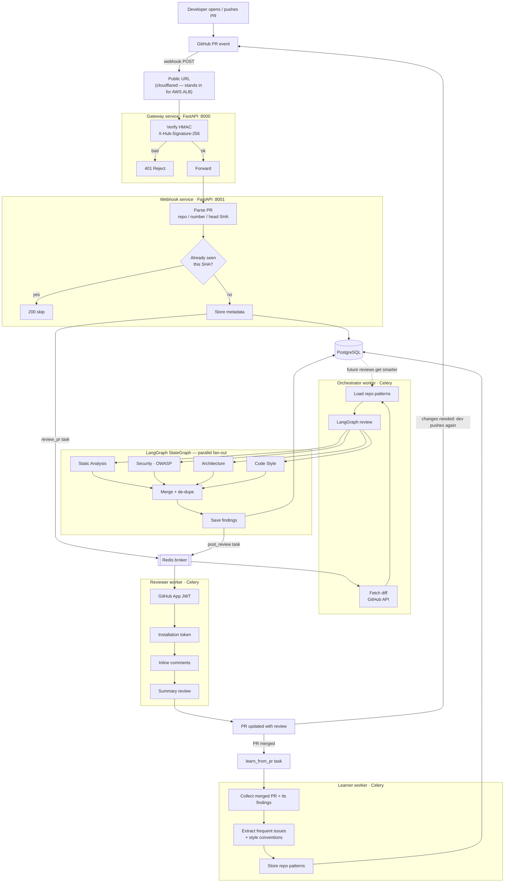

# AI PR Code Reviewer — build plan

An event-driven GitHub Pull Request reviewer. A GitHub App webhook triggers a multi-agent LangGraph pipeline
(Static Analysis, Security/OWASP, Architecture, Code Style running **in parallel** on GPT-4o-mini). Their findings are
merged, de-duplicated and stored, then posted back to the PR as inline comments plus a summary review. A **Learner**
studies merged PRs so later reviews follow each repo's own conventions.

**Runs on:** local `docker compose`. A Cloudflare quick tunnel stands in for the AWS ALB. The AWS parts (ECR, EKS,
GitHub Actions deploy) are written as files and documented, **not deployed**.

---

## 1. Architecture



### The five services

| Service | Kind | Job |
|---|---|---|
| **gateway** | FastAPI (public) | The only public entry point. Checks the HMAC signature, rejects fakes, forwards verified events to `webhook`. Also proxies the read API (`/api/reviews…`). |
| **webhook** | FastAPI (internal) | Parses `pull_request` events, de-duplicates by `(repo, PR, head_sha)` and `X-GitHub-Delivery`, stores metadata, enqueues Celery tasks. |
| **orchestrator** | Celery worker (+ small FastAPI for health/metrics) | Fetches the diff, loads repo patterns, runs the LangGraph review, saves findings, enqueues `post_review`. |
| **reviewer** | Celery worker (+ FastAPI) | GitHub App JWT → installation token → posts one PR review containing the inline comments and the summary. |
| **learner** | Celery worker (+ FastAPI) | On merged PRs: mines frequent issues and style conventions into `repo_patterns`. |

All five live in one Python project (one `pyproject.toml`, one lockfile) and share the `common/` package: settings, SQLAlchemy models, the async DB session, the Celery app,
the GitHub client and metrics helpers. Each service has its own Dockerfile and its own Celery queue (`review`,
`post`, `learn`), so they can scale separately.

### Which PR events do what

| Event | Action |
|---|---|
| `pull_request.opened`, `reopened`, `ready_for_review` | Full review |
| `pull_request.synchronize` (new commits) | Review the new head SHA; the previous review stays on the PR |
| Draft PRs | Ignored until `ready_for_review` |
| `pull_request.closed` with `merged: true` | `learn_from_pr` |
| Anything else / `ping` | 200, ignored |

---

## 2. The LangGraph review engine

```mermaid
flowchart LR
    START --> prep[prepare<br/>parse diff, filter files,<br/>chunk, inject patterns]
    prep --> static & security & arch & style
    static & security & arch & style --> merge[merge_findings<br/>de-dupe + rank + cap]
    merge --> summarize[summarize<br/>overall verdict]
    summarize --> END
```

- **State:** a `TypedDict` whose `findings` field uses `Annotated[list[Finding], operator.add]`. That reducer is
  what lets four nodes write to the same key at the same time; LangGraph runs nodes that share a superstep in parallel.
- **Each agent** calls GPT-4o-mini via `with_structured_output(AgentFindings)` (Pydantic). Each finding has: `file`,
  `line`, `severity` (critical/high/medium/low/info), `category`, `title`, `explanation`, `suggestion` (optional code),
  and `confidence`.
- **Agent focus**
  - *Static Analysis:* bugs, null handling, unhandled errors, dead code, complexity, resource leaks.
  - *Security:* mapped to **OWASP Top 10 (2021)**: A01 Broken Access Control … A10 SSRF, plus hard-coded secrets. Every
    finding carries its OWASP id.
  - *Architecture:* layering, coupling, SOLID, duplication, API and design-pattern misuse.
  - *Code Style:* naming, readability, idioms, **plus the repo's learned conventions** from the Learner.
- **Merge:** drop findings on lines that are not in the diff (GitHub rejects those). Drop findings below the
  confidence threshold. De-duplicate by `(file, line ±2, normalised title)`, keeping the higher severity and noting
  both agents. Sort by severity. Cap at about 25 inline comments per review; the rest go into the summary.
- **Diff handling:** skip lockfiles, generated code, vendored files, binaries and very large files. Large PRs are
  chunked per file. Every agent prompt gets the hunks with **new-file line numbers** written in, so the model returns
  real line numbers.
- **Prompt injection:** the diff is untrusted input. It sits inside delimiters, the agents have no tools and output
  only the schema, and nothing in the diff is ever executed.
- **Offline CLI** for fast iteration without GitHub: `uv run review-cli path/to/change.patch`.

---

## 3. Data model (PostgreSQL · SQLAlchemy 2 async + asyncpg · Alembic)

```mermaid
erDiagram
    installations ||--o{ repositories : has
    repositories ||--o{ pull_requests : has
    repositories ||--o{ repo_patterns : learns
    pull_requests ||--o{ review_runs : "one per head SHA"
    review_runs ||--o{ findings : produces
    webhook_deliveries }o--|| repositories : about

    installations { bigint id PK "GitHub installation id"; text account_login }
    repositories { bigint id PK "GitHub repo id"; bigint installation_id FK; text full_name; bool enabled }
    pull_requests { uuid id PK; bigint repo_id FK; int number; text title; text author; text state; bool merged; timestamptz merged_at }
    review_runs { uuid id PK; uuid pr_id FK; text head_sha "UNIQUE(pr_id, head_sha)"; text status; int files_reviewed; int tokens_in; int tokens_out; numeric cost_usd; text langfuse_trace_id; bigint github_review_id; timestamptz started_at; timestamptz finished_at; text error }
    findings { uuid id PK; uuid run_id FK; text agents; text severity; text category; text owasp_id; text file; int line; text title; text body; text suggestion; float confidence; text fingerprint; bool posted }
    repo_patterns { uuid id PK; bigint repo_id FK; text kind "frequent_issue | convention"; text pattern; int frequency; timestamptz last_seen }
    webhook_deliveries { text delivery_id PK; text event; text action; timestamptz received_at }
```

Status flow for `review_runs`: `queued → fetching → reviewing → saved → posting → posted`, or `failed` / `skipped`.
Each Celery step is **idempotent**: a retried `post_review` checks `github_review_id` before posting again.

---

## 4. The Learner (feedback loop)

On every **merged** PR:

1. **Frequent issues:** count `(category, normalised title)` across the repo's findings. Anything that keeps coming
   back becomes a `frequent_issue` pattern ("this repo often forgets to close DB sessions").
2. **Conventions:** one GPT-4o-mini call over the merged diff extracts the conventions it follows (naming, error
   handling, test layout, import style). These are merged with the existing conventions, with counts going up rather
   than duplicates being added.
3. **Feedback signal:** 👍/👎 reactions on the bot's comments are read when the PR merges. A finding type that keeps
   getting 👎 is down-weighted, so the bot learns what this team doesn't care about.

The orchestrator puts the top N patterns into the Style and Static prompts. Patterns age out (frequency decays
by `last_seen`), so old habits don't stick around forever.

---

## 5. Observability

| Tool | What it shows |
|---|---|
| **Prometheus** | Each FastAPI service exposes `/metrics` (`prometheus-fastapi-instrumentator`). The Celery workers expose a `prometheus_client` port with these metrics: `reviews_total{status}`, `review_duration_seconds`, `agent_duration_seconds{agent}`, `findings_total{agent,severity}`, `llm_tokens_total{agent,kind}`, `llm_cost_usd_total`, `webhooks_total{event,result}`, `github_api_errors_total`. |
| **Grafana** | A provisioned dashboard (datasource and JSON in the repo) showing review throughput, p50/p95 latency, per-agent latency, findings by severity, token and cost burn, and error rates. |
| **Langfuse** | One trace per review run with a span per agent. It shows prompt, output, tokens, cost and latency. The trace id is saved on `review_runs` so the DB links straight to the trace. |

**Decision — Langfuse hosting:** use **Langfuse Cloud (free tier)** by default: you only paste two keys. Self-hosted
Langfuse v3 adds ClickHouse, MinIO and its own Postgres/Redis (about 6 more containers). It will be an optional compose
profile (`--profile langfuse`). With no keys set, tracing switches off cleanly.

---

## 6. Repository layout

```
pr-reviewer/
├── docker-compose.yml          # postgres, redis, 5 services, 3 workers, prometheus, grafana (+ optional langfuse)
├── setup.sh                    # start | stop | tunnel | logs | migrate | test
├── .env.example
├── pyproject.toml              # one uv project; each service is its own container/process
├── common/                     # shared: config, db models, celery app, github client, diff parser, metrics
├── services/
│   ├── gateway/
│   ├── webhook/
│   ├── orchestrator/           # graph/ (state, agents, prompts, merge), tasks.py, cli.py
│   ├── reviewer/
│   └── learner/
├── migrations/                 # alembic
├── monitoring/                 # prometheus.yml, grafana provisioning + dashboard json
├── deploy/                     # NOT deployed: k8s manifests, ECR/EKS notes
├── .github/workflows/          # ci.yml (lint, test, build); deploy.yml (ECR→EKS, manual trigger)
├── tests/                      # unit + integration (respx-mocked GitHub, fake LLM), eval diffs
└── docs/                       # PLAN.md, SETUP-GITHUB-APP.md, ARCHITECTURE.md, LEARNING-NOTES.md
```

**Stack:** Python 3.12, uv, FastAPI, Celery 5 + Redis 7, PostgreSQL 16, SQLAlchemy 2 (async) + asyncpg, Alembic,
LangGraph + `langchain-openai`, httpx, PyJWT (RS256), Pydantic v2, pytest + respx, ruff.

---

## 7. Build phases (I check in with you after each one)

| # | Phase | Done when |
|---|---|---|
| **0** ✅ | **Scaffold:** uv project, `common/`, compose (Postgres, Redis), Alembic models + first migration, `setup.sh`, `.env.example` | `./setup.sh start` brings infra up and `migrate` creates the tables |
| **1** ✅ | **Ingress:** gateway (HMAC, forward) and webhook (parse, de-dupe, store, enqueue) | Signed fixture payloads give 401 for fakes, a stored row and a queued task, and a duplicate is skipped. Tests pass. |
| **2** ✅ | **GitHub App:** you create the App (I write `SETUP-GITHUB-APP.md`), plus JWT → installation token (cached), diff fetch and a diff parser with line mapping | A real PR on your test repo produces a parsed diff in the worker logs |
| **3** | **LangGraph engine:** 4 parallel agents, merge/de-dupe, summary, save to DB, offline CLI, a small eval set (diffs with planted SQL injection, secrets, N+1 and so on) | The CLI finds the planted issues, and the parallel run shows in the logs/trace |
| **4** | **Reviewer:** one review with inline comments and a summary, idempotent posting | Opening a PR on the test repo → review comments appear on the right lines |
| **5** | **Learner:** merged-PR mining, conventions, 👍/👎 feedback, patterns put into prompts | After a merge, `repo_patterns` fills and the next review's prompt includes them |
| **6** | **Observability:** metrics everywhere, Grafana dashboard, Langfuse traces | The dashboard shows a live review; the Langfuse trace has 4 agent spans |
| **7** | **DevOps (files only):** Dockerfiles tidied, GitHub Actions CI, K8s manifests, ECR/EKS write-up | CI runs green locally (`act`, optional); manifests pass `kubectl apply --dry-run=client` |

### What you'll need to provide

- **OpenAI API key.** Use your *new* key; the SwarmAI and travel-planner rotation is still open.
- **A GitHub test repo** and permission to create a **GitHub App** on your account (Phase 2). Permissions: Pull
  requests R/W, Contents R, Metadata R. Events: Pull request. You will download the private key `.pem` into
  `pr-reviewer/secrets/` (git-ignored).
- **Langfuse Cloud keys** (Phase 6), or say if you'd rather self-host.

### Cost guard-rails

GPT-4o-mini is cheap: a typical PR costs a fraction of a cent across the four agents. To be safe there's a per-PR
limit (`MAX_DIFF_LINES`, default 3000; larger PRs get a "too large, reviewed first N files" note) and a daily token
budget that stops new reviews when it's hit.

---

## 8. Mapping to the learning goals

| Goal | Where it's learned |
|---|---|
| Parallel agents with LangGraph `StateGraph` and merging their outputs | Phase 3: fan-out edges, reducer on `findings`, merge node |
| Event-driven FastAPI microservices, GitHub webhooks, Celery + Redis, Postgres | Phases 0, 1, 2 and 4 |
| GitHub App JWT auth | Phases 2 and 4 |
| LLM observability (Langfuse) and system metrics (Prometheus/Grafana) | Phase 6 |
| Self-improving feedback loop | Phase 5 |
| CI/CD and cloud deployment shape | Phase 7 |
